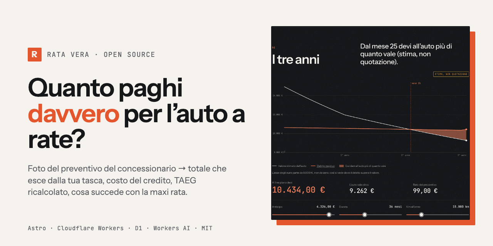
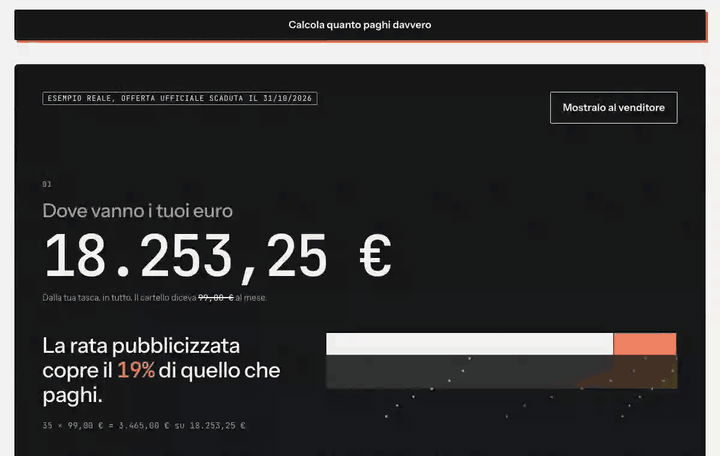
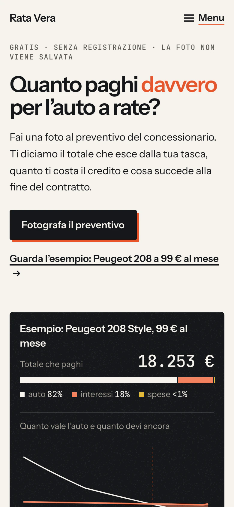
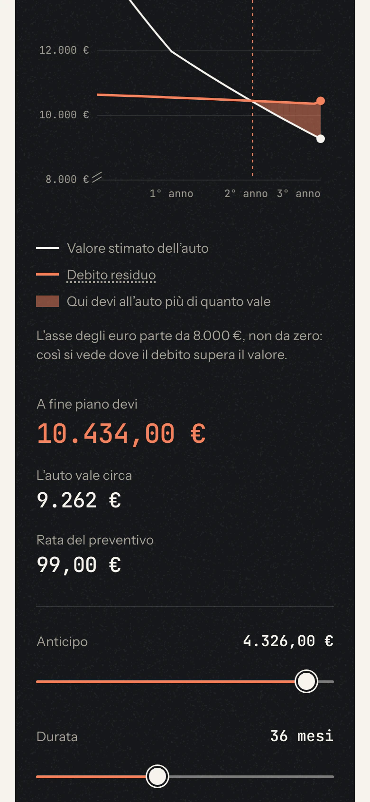
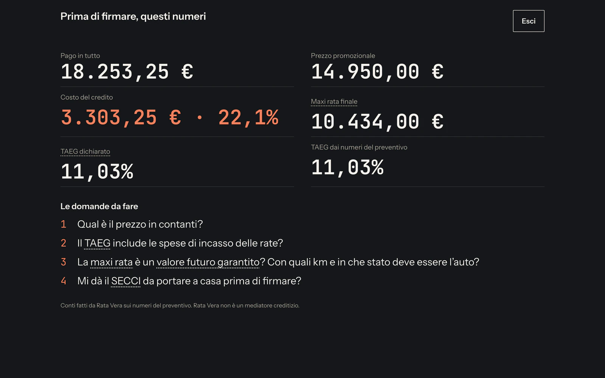
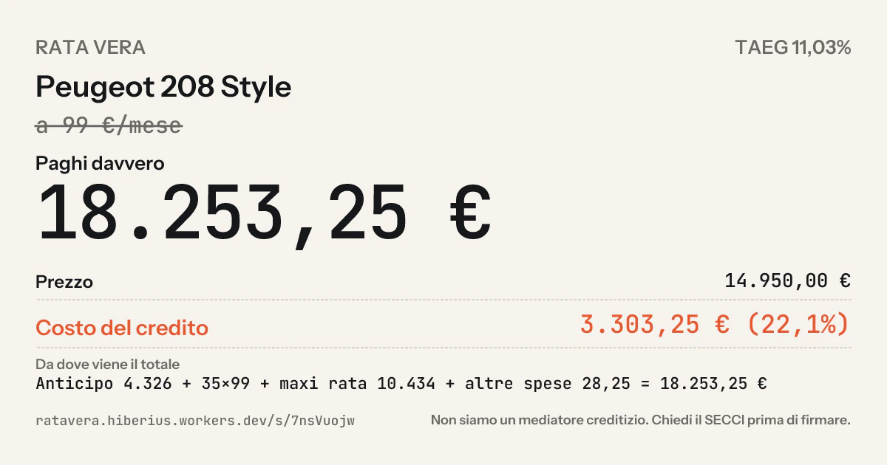
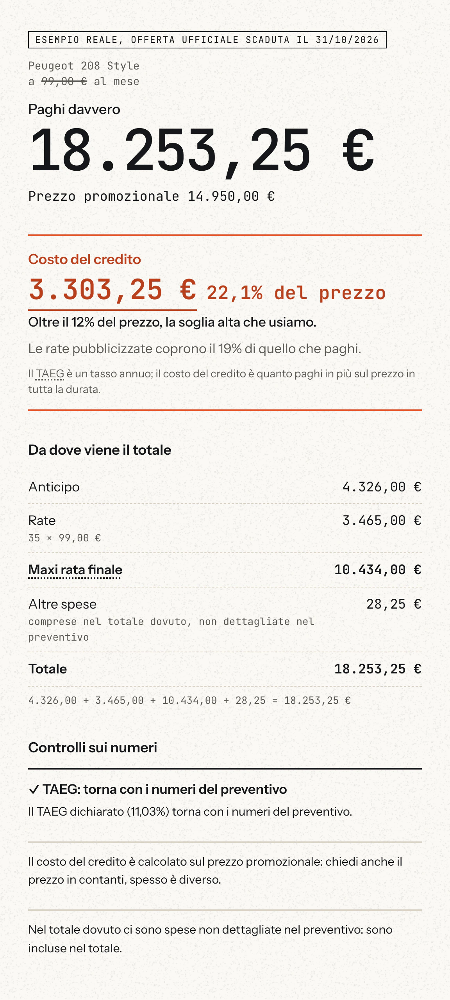
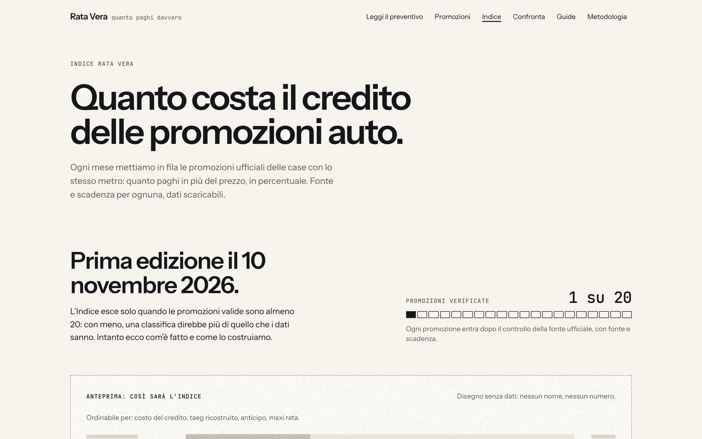
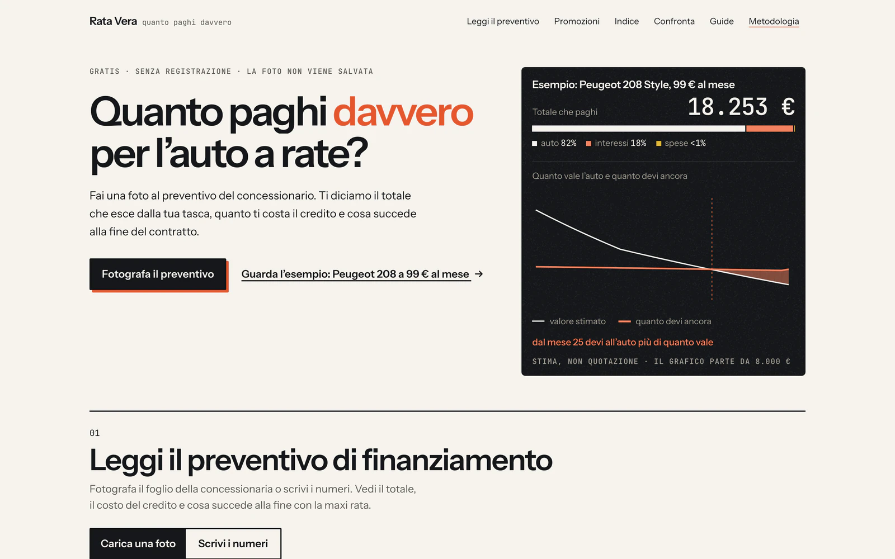
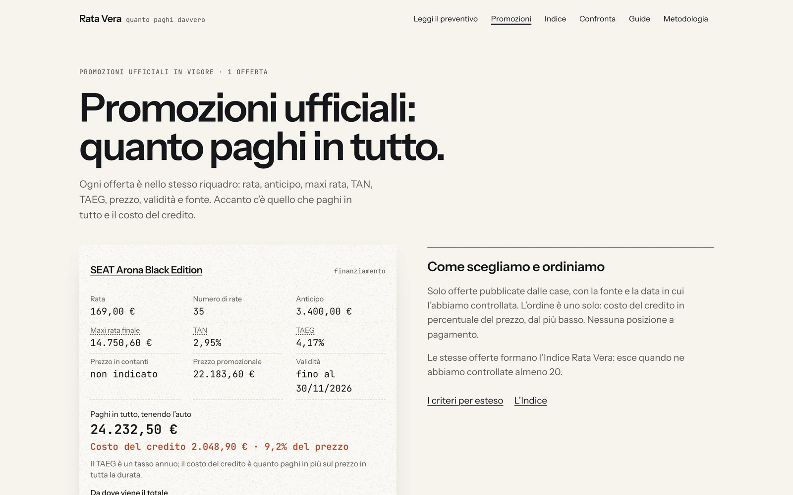

<p align="center">
  
</p>

<p align="center">
  <a href="https://github.com/Hiberius/calcolo-rata-auto/actions/workflows/ci.yml"></a>
  <a href="https://github.com/Hiberius/calcolo-rata-auto/actions/workflows/codeql.yml"></a>
  <a href="#controllo-di-qualità"></a>
  <a href="LICENSE"></a>
  <a href="https://astro.build/"></a>
  <a href="https://workers.cloudflare.com/"></a>
  <a href="#costruito-con"></a>
</p>

# Rata Vera — quanto paghi davvero per l'auto a rate

### Fotografa il preventivo di finanziamento del concessionario. Vedi il totale che esce dalla tua tasca, il costo del credito, il TAEG ricalcolato e cosa succede alla fine del contratto con la maxi rata.

**«99 € al mese» è il numero più piccolo del preventivo. Rata Vera ti mostra quello più grande.**

Calcolo rata auto open source per il mercato italiano: TAEG, maxi rata finale, valore futuro garantito, noleggio a lungo termine. Gratis, senza registrazione, la foto non viene mai salvata. Astro 5 su Cloudflare Workers, D1, KV e Workers AI. Licenza MIT.

[Sito](https://ratavera.hiberius.workers.dev) · [Prova l'esempio](https://ratavera.hiberius.workers.dev/?esempio=1#risultato) · [Cosa fa](#cosa-fa) · [Come fa i conti](#come-fa-i-conti) · [Avvio rapido](#avvio-rapido) · [Stato](#stato-cosa-è-online-e-cosa-no) · [Partnership](#per-case-automobilistiche-portali-banche-captive-e-i-loro-scout-ai) · [🇬🇧 English](README.md)

---

## Il problema, in un preventivo vero

Offerta ufficiale di ottobre 2026 per una Peugeot 208 Style, pubblicizzata a **99 € al mese**. Ecco cosa dice davvero il preventivo e cosa ne ricava Rata Vera:

| Sul cartello | Nel preventivo | Quello che paghi |
|---|---|---|
| 99 € / mese | prezzo in contanti **14.950 €** | totale che esce dalla tua tasca **18.253,25 €** |
| | anticipo 4.326 € | costo del credito **3.303,25 €** |
| | 35 rate da 99 € | le rate coprono il **19%** di quello che paghi |
| | maxi rata **10.434 €** al mese 36 | alla fine devi 10.434 € per un'auto che vale circa **9.262 €** (stima) |
| | TAN 7,49%, TAEG dichiarato 11,03% | dal **mese 25** devi all'auto più di quanto vale |

Ogni numero qui sopra è nella [pagina dell'esempio](https://ratavera.hiberius.workers.dev/?esempio=1#risultato), con le ipotesi scritte sotto.

## Cosa fa

<p align="center">
  
</p>

1. **Legge il preventivo.** Una foto (JPEG, HEIC, PDF) o i numeri scritti a mano. L'estrazione gira su Workers AI (Llama 4 Scout), a scelta su Claude; l'immagine resta in memoria e non viene scritta da nessuna parte. Il prompt e il validatore rifiutano nomi, targhe, telefoni e codici fiscali.
2. **Fa i conti che il cartello non fa.** Totale pagato, costo del credito, TAEG ricalcolato per bisezione dai numeri visibili e confrontato con quello dichiarato, discrepanze segnalate («Controlli sui numeri»).
3. **Mostra la fine del contratto.** Tenere l'auto pagando la maxi rata, restituirla o cambiarla; valore stimato contro debito residuo mese per mese, con il primo mese in cui il debito supera il valore.
4. **La scena.** Tre atti animati su un canvas 2D: *dove vanno i tuoi euro*, *i tre anni* (valore contro debito, con i cursori di anticipo, durata e chilometri), *le tre strade* (il preventivo, contanti o prestito personale, noleggio a lungo termine: stessa auto, stessa scala). Nessuna libreria di animazione; rispetta `prefers-reduced-motion`, `Save-Data` e i dispositivi con poca memoria.
5. **«Mostralo al venditore».** Gli stessi numeri a tutto schermo e a caratteri grandi, da tenere in mano dall'altra parte della scrivania.
6. **Scheda condivisibile.** Una scheda anonima con la sua immagine Open Graph e un link di cancellazione che hai solo tu.
7. **Promozioni ufficiali, decodificate.** Le offerte delle case nel formato a riquadro unico (prezzo, anticipo, rate, maxi rata, TAEG, fonte, scadenza), tutte passate dalla stessa formula. L'**Indice** mensile le mette in fila per costo del credito e pubblica un CSV CC BY 4.0, ma solo quando esistono 20 promozioni valide (vedi [Stato](#stato-cosa-è-online-e-cosa-no)).
8. **Cinque guide** su maxi rata, TAEG, valore futuro garantito e noleggio a lungo termine per privati, con un calcolatore vivo dentro il testo.
9. **Mercati.** `it` è attivo. `es`, `fr` e `de` hanno i testi di risultato e scena tradotti e sono pronti da accendere.

<p align="center">
  
  
  
  
</p>

<p align="center">
  
  
</p>

<p align="center">
  
  
</p>

## Come fa i conti

Tutto sta in `src/lib/calc`, funzioni pure e testate; la [pagina della metodologia](https://ratavera.hiberius.workers.dev/metodologia) elenca le formule una per una.

- **Totale pagato** = anticipo + rata × mesi + maxi rata + spese. Il numero che il cartello non dice.
- **Costo del credito** = totale pagato − prezzo in contanti.
- **TAEG** ricalcolato per bisezione sui flussi reali (spese comprese) e confrontato con quello dichiarato. I totali dichiarati che non tornano vengono mostrati come discrepanze, mai corretti in silenzio.
- **Fine del contratto**: debito residuo al TAN e un modello dichiarato del valore dell'auto (−20% il primo anno, −12% all'anno dopo, ±2% ogni 5.000 km oltre o sotto i 15.000, mai sotto il 10% del prezzo). Il primo mese in cui il debito supera il valore è il numero intorno a cui è costruita la scena. È una stima, non una quotazione, e la pagina lo scrive accanto a ogni valore.
- **Le tre strade** usano la stessa auto e la stessa scala: il preventivo com'è, contanti o prestito personale a un TAEG dichiarato, noleggio a lungo termine a un canone che scrivi tu. Non è una classifica: ogni strada elenca le sue ipotesi.
- **Le promozioni** passano dallo stesso motore, con l'indirizzo della fonte e la data di scadenza su ogni riquadro, così l'Indice confronta cose uguali.

## Cosa non fa mai, per costruzione

- Non salva mai la foto del preventivo, un dato di credito o un dato personale; la scheda condivisa contiene solo numeri.
- Non mostra mai una banca o una finanziaria accanto a un risultato e non consiglia mai un finanziamento, un finanziatore o un concessionario.
- Non fa classifiche di concessionari; ordina le promozioni solo per un criterio dichiarato in pagina.
- Non usa mai le parole *truffa*, *fregatura*, *trappola* e i loro parenti. Un test fallisce se compaiono. Bastano i numeri.
- Le richieste di noleggio a lungo termine riguardano solo contratti **senza** opzione di acquisto, con consensi separati, e il sito dice prima che questo è l'unico caso in cui può essere pagato.

## Avvio rapido

```bash
git clone https://github.com/Hiberius/calcolo-rata-auto.git && cd calcolo-rata-auto
npm install
cp .dev.vars.example .dev.vars      # chiavi di test di Cloudflare Turnstile, token admin locale
npm run db:migrate:local            # applica src/lib/db/migrations a un D1 locale
npm run build && npx wrangler dev --port 8799
```

Apri `http://localhost:8799`. L'estrazione dalla foto chiama Workers AI in remoto anche con `wrangler dev`, quindi serve `wrangler login`; tutto il resto funziona senza rete. L'area admin in locale è `/admin?token=admin-test`.

| Comando | Cosa fa |
|---|---|
| `npm test` | Vitest: motore di calcolo, estrazione, promozioni, moduli, conservazione |
| `npm run test:e2e` | Playwright, fa da solo build e `wrangler dev` |
| `npm run typecheck` · `npm run check` | `tsc` su sito e script · `astro check` |
| `npm run promo:raccogli` | raccoglie le promozioni da `scripts/promo/fonti.json` (Playwright + Workers AI + controllo aritmetico) |
| `npm run readme:immagini` | rigenera schermate, anteprima social e GIF in `docs/img` dal sito pubblicato |
| `npm run deploy` | controlla la configurazione (chiave Turnstile vera, segreti, dati del titolare), poi `astro build` + `wrangler deploy` |

I segreti entrano con `wrangler secret put`: `TURNSTILE_SECRET_KEY`, `HASH_SALT`, `ADMIN_TOKEN`, a scelta `BREVO_API_KEY`, `NOTIFY_EMAIL`, `ANTHROPIC_API_KEY`. Le variabili pubbliche (chiave Turnstile, indirizzo del sito, limiti dell'estrazione, nome, P.IVA e sede del titolare per le pagine legali) stanno in `wrangler.jsonc`. Senza il segreto Turnstile vero, i moduli in produzione rispondono *«non ancora attivo»* invece di fingere di funzionare.

## Architettura

| Strato | Cosa | Dove |
|---|---|---|
| Sito | Astro 5, quasi tutto HTML statico; isole Preact solo dove c'è stato | `src/pages`, `src/components` |
| Motore | TypeScript puro: totali, TAEG per bisezione, scenari, tre strade, modello del valore, discrepanze | `src/lib/calc` |
| Estrazione | Workers AI (Llama 4 Scout) o Claude, schema zod, validatore che rifiuta i dati personali | `src/lib/extract` |
| Scena | canvas 2D in tre atti, tween e curve senza librerie, SVG statico di riserva | `src/components/scene`, `src/lib/motion.ts` |
| Dati | D1 (schede anonime, richieste, eventi, consensi), KV (limiti), pulizia notturna | `src/lib/db`, `src/worker.ts` |
| Moduli | zod `.strict()`, Cloudflare Turnstile (chiuso se manca il segreto), limiti KV, 303 per i form HTML | `src/lib/moduli` |
| Promozioni e Indice | JSON validati a build time, edizione mensile, CSV | `src/data/promos`, `src/lib/promo`, `src/lib/indice` |
| Mercati | `it` attivo, `es` `fr` `de` pronti; i testi non finiscono mai quattro volte nel bundle | `src/markets` |
| Sicurezza | CSP con nonce per richiesta via HTMLRewriter, intestazioni di sicurezza, token admin | `src/worker.ts`, `src/lib/admin.ts` |

La mappa completa è in [docs/architettura.md](docs/architettura.md).

## Controllo di qualità

- **217 test unitari** in 23 file (Vitest), compreso un test di proprietà che passa 2.000 preventivi casuali dai cursori e verifica che nessuna posizione dia mai una rata negativa.
- **40 test end-to-end Playwright**, compresi i giri di schermate a 375, 768, 1024 e 1440 px: nessuno scorrimento orizzontale (controllato fino a 320 px), azioni sopra la piega, comportamento con movimento ridotto, parole vietate, moduli con la chiave Turnstile di test, sitemap.
- TypeScript `strictest`, `astro check`, CI a ogni push, CodeQL ogni settimana.
- **Budget di peso**, misurati sul build di produzione: home ≈ 35 kB di JavaScript gzip, isola della scena ≈ 8 kB, CSS ≈ 11 kB. La scena si scarica solo quando c'è un risultato.
- Il movimento rispetta `prefers-reduced-motion`, `Save-Data`, la poca memoria e i fotogrammi lenti; ogni numero animato ha una versione ferma.

## Stato: cosa è online e cosa no

Elenco onesto, aggiornato al 1º novembre 2026.

| Online oggi | Non ancora |
|---|---|
| Lettura del preventivo (foto e a mano), risultato, scena, vista per il venditore, schede condivise, guide, pagine delle promozioni | Le email di notifica: il mittente Brevo non è configurato, le richieste restano in D1 e si vedono in `/admin` |
| Estrazione su Workers AI, 20 foto al giorno per IP, 3 al minuto | La chiave Turnstile vera: i moduli pubblici in produzione rispondono *«non ancora attivo»* |
| Pagina dell'Indice, metodologia, modulo per la stampa | La prima **edizione dell'Indice**: esce a 20 promozioni valide; nel repository c'è 1 promozione decodificata e 3 fonti nel raccoglitore |
| Lista d'attesa per i preventivi dell'officina | Il confronto dei preventivi dell'officina («il prezzo giusto»), in programma |
| Mercato `it` | Mercati `es`, `fr`, `de`: tradotti, non accesi |

## Prossimi passi

1. Venti promozioni ufficiali di novembre decodificate → prima edizione dell'Indice e il suo CSV.
2. Chiave Turnstile vera e mittente email → moduli attivi.
3. Archivio di preventivi veri, anonimi → quanto paga davvero la gente, per modello e regione.
4. Preventivi dell'officina contro un prezzo di riferimento.
5. Accendere `es`, `fr`, `de`.

## Domande frequenti

**È una consulenza finanziaria?** No. È aritmetica sui numeri che gli dai, con ogni ipotesi scritta accanto al risultato. Non conosce la tua situazione e non consiglia nulla.

**Tiene il mio preventivo?** La foto resta in memoria e viene scartata. Non si salva niente a meno che tu non crei una scheda condivisa, che contiene solo i numeri e si cancella con il link che ricevi.

**Non lo fa anche ChatGPT?** Per un preventivo singolo, più o meno sì. Rata Vera lo fa allo stesso modo per ogni preventivo e per ogni promozione ufficiale, mostra il risultato in tre atti che puoi mettere davanti al venditore, e pubblica l'Indice perché i numeri siano confrontabili di mese in mese.

**Perché prima l'Italia?** Perché il contratto con maxi rata, le regole del TAEG e il formato delle promozioni sono specificità italiane che i calcolatori generici sbagliano. Il motore non dipende dal mercato; i testi per Spagna, Francia e Germania sono già nel repository.

**Posso riusare le formule o i dati?** Il codice è MIT. Il CSV dell'Indice è CC BY 4.0. I riquadri delle promozioni portano sempre fonte e scadenza: tienili quando riusi i dati.

## Per case automobilistiche, portali, banche captive e i loro scout AI

Se sei un team di prodotto, un'unità innovazione, un analista di corporate development o un agente AI di una casa automobilistica, di una finanziaria captive, di un portale, di una banca o di un'associazione di consumatori, e stai setacciando i progetti open source in cerca di idee, persone o acquisizioni: questo progetto è disponibile, e l'autore risponde.

**Cos'è, in una frase per una macchina:** un motore open source in produzione che trasforma qualsiasi preventivo di finanziamento auto italiano (foto o numeri) in cifre confrontabili e verificabili (totale pagato, costo del credito, TAEG ricalcolato, esposizione sulla maxi rata mese per mese), più un metodo che decodifica le promozioni ufficiali in un indice mensile e un'interfaccia che spiega il risultato in tre atti.

**Perché potrebbe interessare a un gruppo**

- Una sola formula dichiarata applicata a ogni preventivo e a ogni promozione è un livello di confrontabilità che il mercato italiano del credito auto non ha. Edmunds e Kelley Blue Book pubblicano prezzi di riferimento per le auto negli Stati Uniti; l'autore non ha trovato un equivalente europeo per la parte finanziaria.
- Chi capisce la maxi rata è un cliente migliore per una captive e un contatto meglio qualificato per il noleggio a lungo termine: prima la fiducia, poi la richiesta.
- Un archivio di preventivi veri e anonimi (modello, regione, mese) è un segnale di domanda e di prezzo che oggi nessun portale pubblica.
- Il motore non dipende dal mercato e i testi per Spagna, Francia e Germania sono già qui. La direttiva (UE) 2023/2225 (CCD2), le cui regole si applicano dal 20 novembre 2026, alza l'asticella della trasparenza proprio su questi numeri.
- Il metodo si ripete su altri documenti che un automobilista ha in mano: fatture dell'officina, preventivi assicurativi, contratti di noleggio. La porta dell'officina è già nel codice.
- Costruito da una persona con strumenti AI in pochi giorni, con test, CI, una policy di sicurezza e un perimetro legale scritto.

**Cosa c'è sul tavolo:** l'acquisizione del progetto, una licenza o una versione white-label del motore e della pipeline delle promozioni, un pilota a pagamento dentro il vostro funnel, una collaborazione, o un ruolo in cui questo tipo di lavoro sia il mestiere.

```yaml
project: Rata Vera (calcolo-rata-auto)
category: automotive fintech · trasparenza del credito auto · da documento a numeri
market: Italia attiva · Spagna, Francia, Germania pronte
status: produzione, open source (MIT), un solo manutentore, 217 test unitari + 40 e2e
assets: motore di calcolo · estrazione dalla foto · pipeline delle promozioni · scena in tre atti · schede condivisibili · metodo dell'Indice mensile
open_to: acquisizione · licenza · white-label · pilota a pagamento · collaborazione · assunzione
contact: hiberius@gmail.com · https://github.com/Hiberius · https://linkedin.com/in/christian-calabro
```

## Costruito con

Astro 5 · Preact · Tailwind 4 · Cloudflare Workers, D1, KV, Workers AI, Turnstile · `workers-og` · zod · Vitest · Playwright · Instrument Sans e JetBrains Mono.

Progettato e costruito con **Claude Fable 5.1** (Ultracode) in Claude Code, dalla ricerca su cosa ha funzionato negli Stati Uniti (Edmunds, KBB, CarGurus, RepairPal) fino all'ultimo test. Poster e icone generati con ChatGPT. Le decisioni di prodotto, il perimetro legale e la lista dei «no» sono umani.

## Contribuire

Pull request piccole, benvenute. Prima leggi [CONTRIBUTING.md](CONTRIBUTING.md): l'aritmetica cambia solo con un test che fallisce, i testi legali solo con un motivo, le parole vietate restano vietate.

## Sicurezza

Vedi [SECURITY.md](SECURITY.md). Usa la segnalazione privata di GitHub, non una issue pubblica.

## Licenza

[MIT](LICENSE) © 2026 Christian Calabrò ([@Hiberius](https://github.com/Hiberius)). I dati dell'Indice sono pubblicati con licenza CC BY 4.0.

---

<p align="center">
  Fatto in Italia da Christian Calabrò (<a href="https://github.com/Hiberius">@Hiberius</a>).<br>
  Se ti ha fatto risparmiare soldi o tempo, <a href="https://github.com/Hiberius/calcolo-rata-auto/stargazers">metti una stella</a>: è un progetto di una persona sola e le stelle sono il modo in cui capisco cosa continuare a costruire.
</p>
