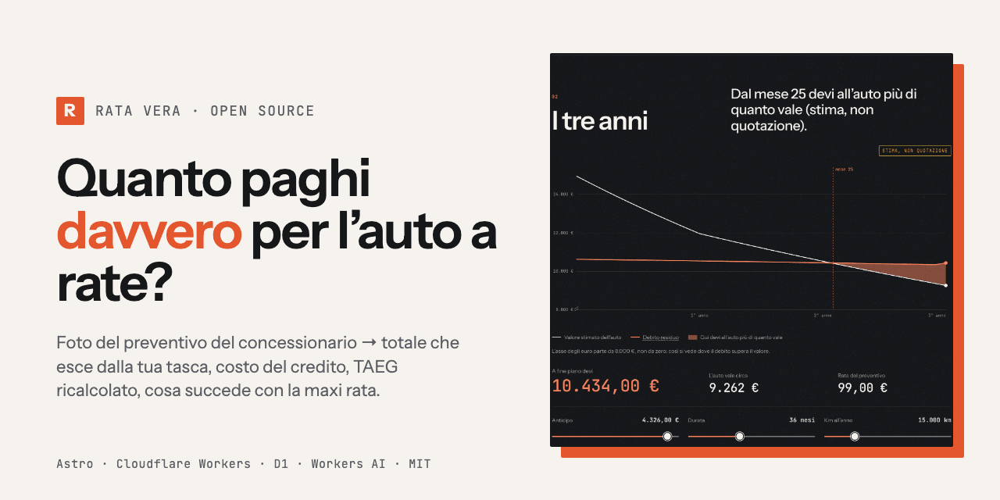
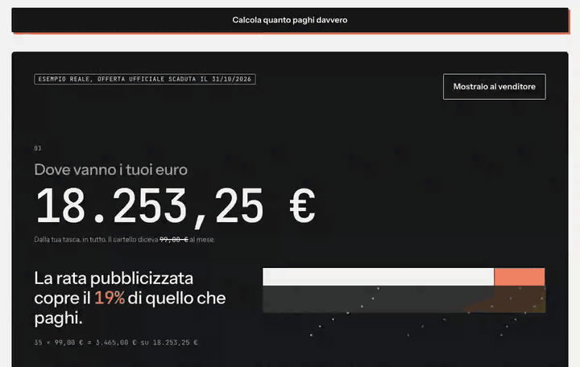
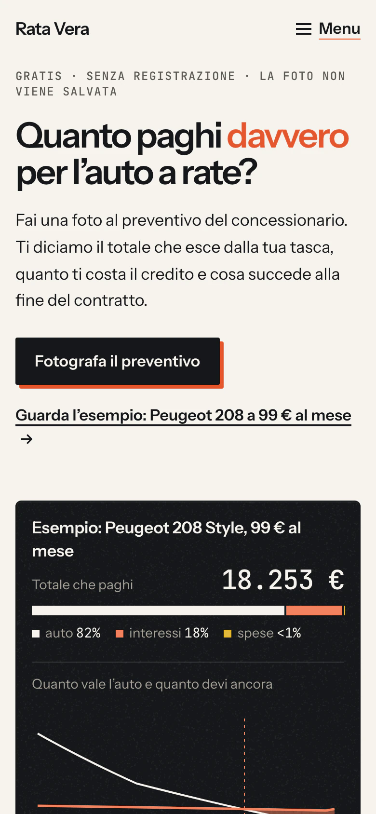
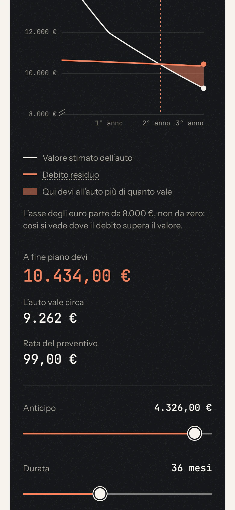
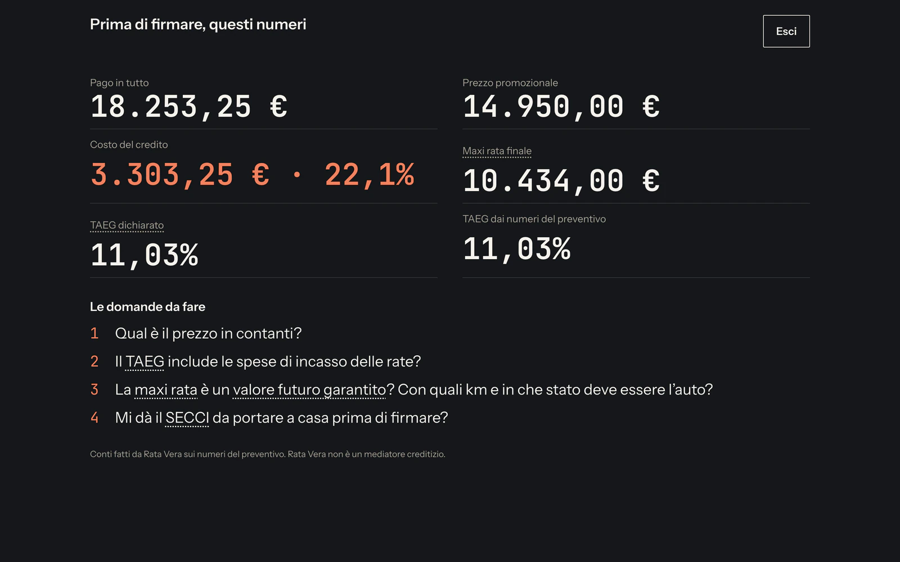
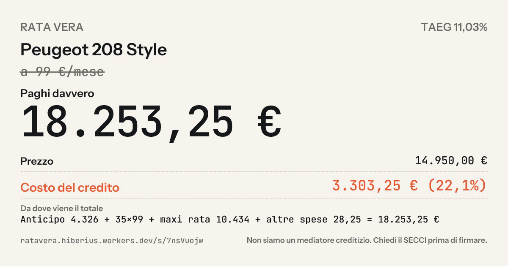
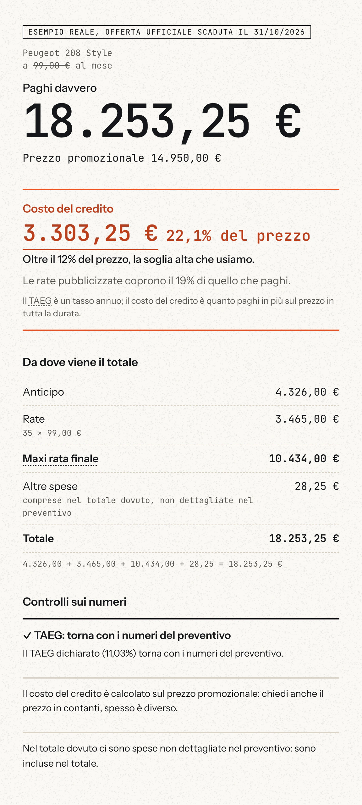
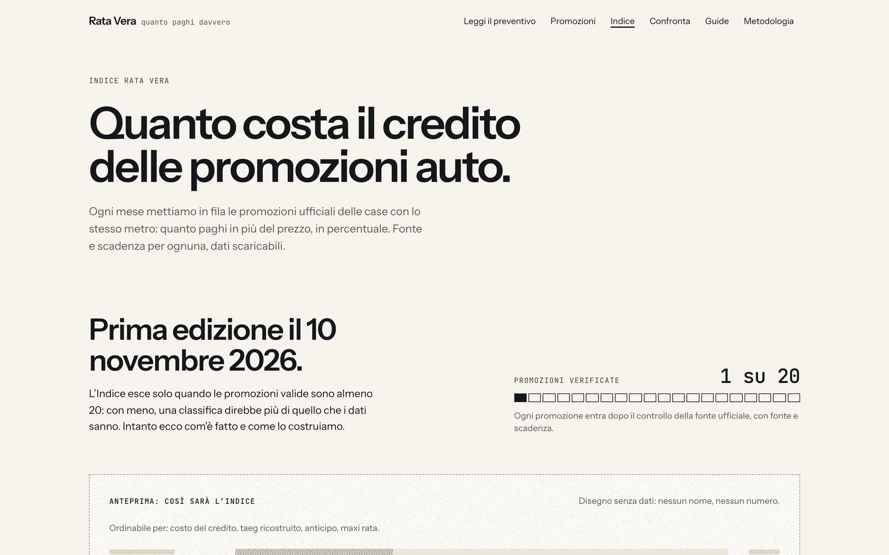

<p align="center">
  
</p>

<p align="center">
  <a href="https://github.com/Hiberius/ratavera/actions/workflows/ci.yml"></a>
  <a href="https://github.com/Hiberius/ratavera/actions/workflows/codeql.yml"></a>
  <a href="#quality-gate"></a>
  <a href="LICENSE"></a>
  <a href="https://astro.build/"></a>
  <a href="https://workers.cloudflare.com/"></a>
  <a href="#built-with"></a>
</p>

# Rata Vera — the real cost of a car bought in instalments

### Photograph the dealer's finance quote. See the total you actually pay, the cost of credit, the recomputed APR and what the balloon payment does at the end of the contract.

**"€99 a month" is the smallest number on the quote. Rata Vera shows you the biggest one.**

Open-source car finance calculator for the Italian market (*calcolo rata auto*, *TAEG*, *maxi rata finale*, *noleggio a lungo termine*). Free, no sign-up, the photo is never stored. Astro 5 on Cloudflare Workers, D1, KV and Workers AI. MIT.

[Live site](https://ratavera.hiberius.workers.dev) · [Try the example](https://ratavera.hiberius.workers.dev/?esempio=1#risultato) · [What it does](#what-it-does) · [How the numbers work](#how-the-numbers-work) · [Quickstart](#quickstart) · [Status](#status-what-is-live-and-what-is-not) · [🇮🇹 Italiano](README.it.md)

---

## The problem, in one real quote

An official October 2026 offer for a Peugeot 208 Style, advertised at **€99 a month**. This is what the quote actually says, and what Rata Vera makes of it:

| On the poster | In the quote | What you pay |
|---|---|---|
| €99 / month | cash price **€14,950** | total out of pocket **€18,253.25** |
| | down payment €4,326 | cost of credit **€3,303.25** |
| | 35 instalments of €99 | the instalments cover **19%** of what you pay |
| | balloon payment **€10,434** at month 36 | at the end you owe €10,434 for a car worth about **€9,262** (estimate) |
| | TAN 7.49%, declared APR 11.03% | from **month 25** you owe the car more than it is worth |

Every number above is on the [example page](https://ratavera.hiberius.workers.dev/?esempio=1#risultato), with the assumptions written under it.

## What it does

<p align="center">
  
</p>

1. **Reads the quote.** Take a photo (JPEG, HEIC, PDF) or type the numbers. Extraction runs on Workers AI (Llama 4 Scout), optionally on Claude; the image is processed in memory and never written anywhere. The prompt and the validator refuse names, plates, phone numbers and tax codes.
2. **Does the arithmetic the poster does not.** Total paid, cost of credit, APR recomputed by bisection from the visible numbers and compared with the declared one, discrepancies flagged ("Checks on the numbers").
3. **Shows the end of the contract.** Keep the car and pay the balloon, give it back, or swap it; estimated value against remaining debt month by month, with the first month the debt overtakes the value.
4. **The scene.** Three animated acts on a 2D canvas: *where your euros go*, *the three years* (value vs. debt, with sliders for down payment, duration and mileage), *the three roads* (the quote, cash or a personal loan, long-term rental, same car, same scale). No animation library; respects `prefers-reduced-motion`, `Save-Data` and low-memory devices.
5. **"Show it to the salesperson."** A full-screen, large-type view of the same numbers, meant to be held up across the desk.
6. **Shareable card.** An anonymous card with its own Open Graph image and a deletion link only you hold.
7. **Official promotions, decoded.** Manufacturer offers in the single-box format (price, down payment, instalments, balloon, APR, source, expiry), each one run through the same formula. The monthly **Index** ranks them by cost of credit and publishes a CC BY 4.0 CSV, but only once 20 valid promotions exist (see [Status](#status-what-is-live-and-what-is-not)).
8. **Five guides** on the balloon payment, the APR, the guaranteed future value and long-term rental for private buyers, with a live calculator inside the text.
9. **Markets.** `it` is live. `es`, `fr` and `de` carry translated result and scene texts and are ready to switch on.

<p align="center">
  
  
  
  
</p>

<p align="center">
  
  
</p>

## How the numbers work

Everything lives in `src/lib/calc` as pure, tested functions; the [methodology page](https://ratavera.hiberius.workers.dev/metodologia) lists the formulas one by one.

- **Total paid** = down payment + instalments × months + balloon + fees. The number the poster leaves out.
- **Cost of credit** = total paid − cash price.
- **APR (TAEG)** is recomputed by bisection on the actual cash flows (fees included) and compared with the declared APR. Declared totals that do not add up are shown as discrepancies, never silently corrected.
- **End of contract**: remaining debt at the TAN, and a declared value model for the car (−20% in the first year, −12% a year after, ±2% every 5,000 km from 15,000, never below 10% of the price). The first month the debt exceeds the value is the number the scene is built around. It is an estimate, not a quotation, and the page says so next to every value.
- **The three roads** use the same car and the same scale: the quote as written, cash or a personal loan at a declared APR, long-term rental at a monthly fee you type in. It is not a ranking; each road lists its own assumptions.
- **Promotions** go through the same engine, with the source URL and the expiry date on every box, so the Index compares like with like.

## What it never does, by design

- Never stores a quote photo, a credit score or any personal data; the shared card contains numbers only.
- Never shows a bank or finance company next to a result and never recommends a loan, a lender or a dealer.
- Never ranks dealers; only sorts promotions by a criterion stated on the page.
- Never uses the words *truffa*, *fregatura*, *trappola* or their relatives. A test fails if they appear. Numbers are enough.
- Long-term rental requests are taken only for contracts **without** a purchase option, with separate consents, and the site says upfront that this is the one case in which it can be paid.

## Quickstart

```bash
git clone https://github.com/Hiberius/ratavera.git && cd ratavera
npm install
cp .dev.vars.example .dev.vars      # Cloudflare Turnstile test keys, local admin token
npm run db:migrate:local            # applies src/lib/db/migrations to a local D1
npm run build && npx wrangler dev --port 8799
```

Open `http://localhost:8799`. Photo extraction calls Workers AI remotely even in `wrangler dev`, so it needs `wrangler login`; everything else runs offline. The admin area is `/admin?token=admin-test` locally.

| Command | What it does |
|---|---|
| `npm test` | Vitest: calculation engine, extraction, promotions, forms, retention |
| `npm run test:e2e` | Playwright, builds and starts `wrangler dev` by itself |
| `npm run typecheck` · `npm run check` | `tsc` on site and scripts · `astro check` |
| `npm run promo:raccogli` | collects promotions from `scripts/promo/fonti.json` (Playwright + Workers AI + arithmetic check) |
| `npm run readme:immagini` | regenerates the screenshots, the social preview and the GIF in `docs/img` from the live site |
| `npm run deploy` | checks the configuration (real Turnstile key, secrets, owner data), then `astro build` + `wrangler deploy` |

Secrets go in with `wrangler secret put`: `TURNSTILE_SECRET_KEY`, `HASH_SALT`, `ADMIN_TOKEN`, optionally `BREVO_API_KEY`, `NOTIFY_EMAIL`, `ANTHROPIC_API_KEY`. Public variables (Turnstile site key, site URL, extraction limits, owner name, VAT number and address for the legal pages) live in `wrangler.jsonc`. Without the real Turnstile secret, production forms answer *"not active yet"* instead of pretending to work.

## Architecture

| Layer | What | Where |
|---|---|---|
| Site | Astro 5, mostly static HTML; Preact islands only where there is state | `src/pages`, `src/components` |
| Engine | pure TypeScript: totals, APR by bisection, scenarios, three roads, value model, discrepancies | `src/lib/calc` |
| Extraction | Workers AI (Llama 4 Scout) or Claude, zod schema, validator that refuses personal data | `src/lib/extract` |
| Scene | 2D canvas in three acts, tweens and easing without libraries, static SVG fallback | `src/components/scene`, `src/lib/motion.ts` |
| Data | D1 (anonymous cards, requests, events, consents), KV (rate limits), nightly retention job | `src/lib/db`, `src/worker.ts` |
| Forms | zod `.strict()`, Cloudflare Turnstile (fail-closed), KV limits, 303 for HTML forms | `src/lib/moduli` |
| Promotions and Index | JSON validated at build time, monthly edition, CSV | `src/data/promos`, `src/lib/promo`, `src/lib/indice` |
| Markets | `it` live, `es` `fr` `de` ready; texts never bundled four times | `src/markets` |
| Security | per-request CSP nonce via HTMLRewriter, security headers, admin token | `src/worker.ts`, `src/lib/admin.ts` |

The full map, in Italian like the code, is in [docs/architettura.md](docs/architettura.md).

## Quality gate

- **217 unit tests** in 23 files (Vitest), including a property test that runs 2,000 random quotes through the sliders and checks that no position ever yields a negative instalment.
- **25 Playwright end-to-end tests** plus a screenshot pass at 375, 768, 1024 and 1440 px: no horizontal overflow, actions above the fold, reduced-motion behaviour, banned words, forms with the Turnstile test key, sitemap.
- TypeScript `strictest`, `astro check`, CI on every push, CodeQL weekly.
- **Weight budgets**, measured on the production build: home ≈ 35 kB of JavaScript gzipped, scene island ≈ 8 kB, CSS ≈ 11 kB. The scene only loads when there is a result.
- Motion respects `prefers-reduced-motion`, `Save-Data`, low device memory and slow frames; every animated number has a static fallback.

## Status: what is live and what is not

Honest list, updated 1 November 2026.

| Live today | Not yet |
|---|---|
| Quote reader (photo and manual), result, scene, salesperson view, shared cards, guides, promotions pages | The domain: the site runs on `ratavera.hiberius.workers.dev` until `ratavera.it` is registered |
| Extraction on Workers AI, 20 photos a day per IP, 3 a minute | The real Turnstile key: public forms answer *"not active yet"* in production |
| Index page, methodology, press form | The first **Index edition**: it publishes at 20 valid promotions; the repository holds 1 decoded promotion and 3 sources in the collector |
| Workshop quote waiting list | Workshop quote comparison ("the fair price"), planned |
| Market `it` | Markets `es`, `fr`, `de`: translated, not switched on |

## Roadmap

1. Twenty decoded official promotions for November → first Index edition and its CSV.
2. Domain and real Turnstile key → forms live.
3. Archive of real, anonymous quotes → what people actually pay, by model and region.
4. Workshop quotes against a reference price.
5. Switch on `es`, `fr`, `de`.

## FAQ

**Is this financial advice?** No. It is arithmetic on the numbers you give it, with every assumption written next to the result. It does not know your situation and does not recommend anything.

**Does it keep my quote?** The photo is processed in memory and discarded. Nothing is stored unless you create a shared card, which contains the numbers only and can be deleted with the link you receive.

**Can't ChatGPT do this?** For one quote, roughly yes. Rata Vera does it the same way for every quote and every official promotion, shows the result in three acts you can hand to the salesperson, and publishes the Index so the numbers are comparable from month to month.

**Why Italian first?** Because the balloon-payment contract (*maxi rata*), the APR rules (*TAEG*) and the promotion format are Italian specifics the generic calculators get wrong. The engine is market-agnostic; the texts for Spain, France and Germany are already in the repository.

**Can I reuse the formulas or the data?** The code is MIT. The Index CSV is CC BY 4.0. Promotion boxes always carry their source and expiry; please keep them when you reuse the data.

## Built with

Astro 5 · Preact · Tailwind 4 · Cloudflare Workers, D1, KV, Workers AI, Turnstile · `workers-og` · zod · Vitest · Playwright · Instrument Sans and JetBrains Mono.

Designed and built with **Claude Fable 5.1** (Ultracode) in Claude Code, from research on what worked in the US (Edmunds, KBB, CarGurus, RepairPal) to the last test. Poster and icon images generated with ChatGPT. The product decisions, the legal perimeter and the "no" list are human.

## Contributing

Small pull requests welcome. Read [CONTRIBUTING.md](CONTRIBUTING.md) first: the arithmetic changes only with a failing test, the legal texts only with a reason, and the banned words stay banned.

## Security

See [SECURITY.md](SECURITY.md). Please use GitHub's private vulnerability reporting rather than a public issue.

## License

[MIT](LICENSE) © 2026 Christian Calabrò ([@Hiberius](https://github.com/Hiberius)). The Index data is published under CC BY 4.0.

---

<p align="center">
  Made in Italy by Christian Calabrò (<a href="https://github.com/Hiberius">@Hiberius</a>).<br>
  If it saved you money or time, <a href="https://github.com/Hiberius/ratavera/stargazers">star the repo</a>: it is a one-person project and stars are how I know what to keep building.
</p>
